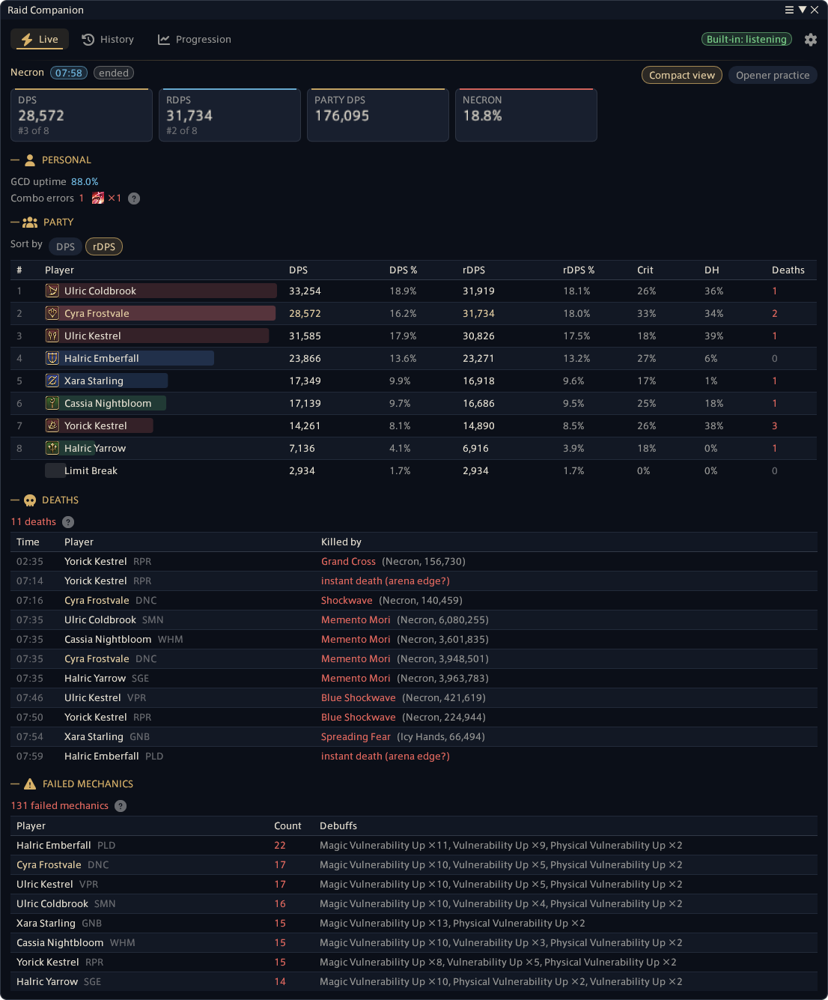
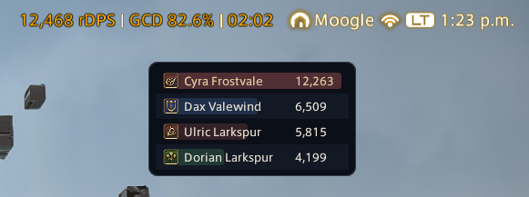
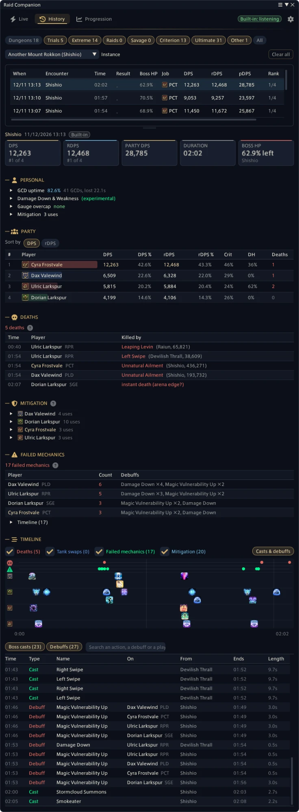
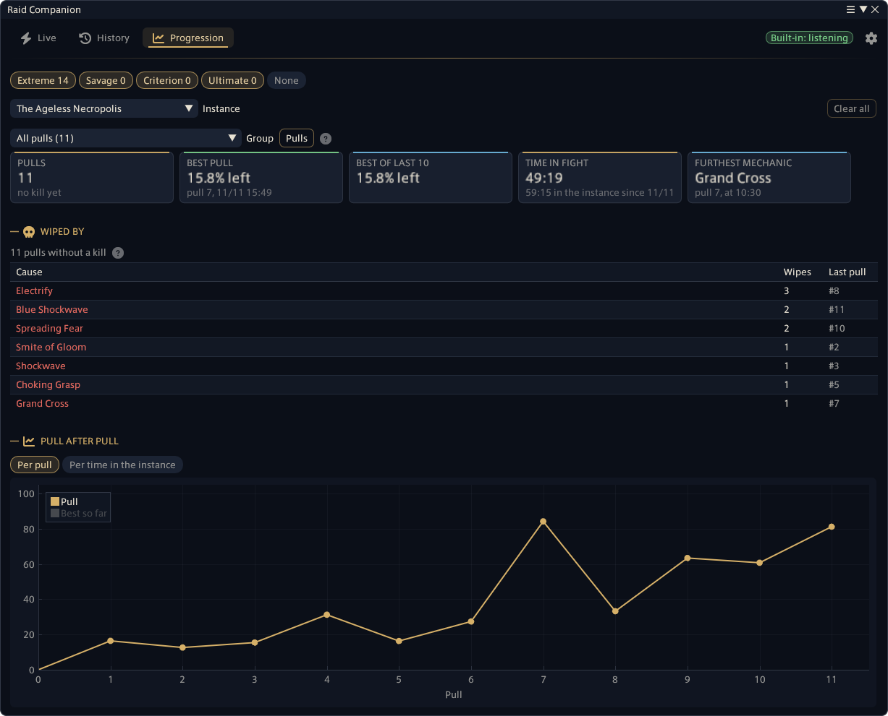

<p align="center">
  
</p>

<h1 align="center">Raid Companion</h1>

<p align="center">
  <b>Advanced Fight Tracker — Let's get gud!</b><br>
  A <a href="https://github.com/goatcorp/Dalamud">Dalamud</a> plugin for FFXIV. Works on its own, or with ACT.
</p>

---

Meant to be your new high-end content buddy: the main features of FFLogs, ACT, xivanalysis and death recaps merged
into one clean, standalone plugin, so you get the info you need on the go, in the same place, inside the game.

- **You** — What's my DPS / rDPS? How did I perform? How was my uptime? Did I miss a positional, drop a combo,
  overcap my resources?
- **Your party** — How did the party perform? How many deaths, and what caused them? How many vulnerabilities and
  damage downs did we take, by whom and when? How was our mitigation?
- **The fight** — Is our damage enough to clear? By how much?

No more logging, uploading and waiting for the end of the session to check: these answers, and more, are ready the
moment it happens, without alt-tabbing. An **opener practice** is included too.

> We do not reinvent the wheel, we polish it!

<p align="center">
  <br>
  <sub>The Live tab after a pull (player names hidden for the screenshot).</sub>
</p>

## Installation

1. In game, open `/xlsettings` → **Experimental** → **Custom Plugin Repositories**.
2. Add:
   ```
   https://raw.githubusercontent.com/FunkyJumbo/DPS-In-Server-Bar/master/pluginmaster.json
   ```
3. Save, then install **Raid Companion** from `/xlplugins`.

**Languages:** English, French and German (Settings > Display > Language; *Auto* follows Dalamud's language).
Game data (actions, bosses, debuffs) stays in your game client's language.

> **That's all you need.** Type `/raidcompanion` in game and go pull something: the plugin is made to be picked up
> without reading a manual. The rest of this page explains each feature in more detail, for when you want to dig in.

<br>
<br>

## Main window

`/raidcompanion` opens the main window, with three tabs: **Live**, **History** and **Progression**.

### Live

See Live as a very detailed DPS meter. You can keep it open during the fight, but it takes room on screen: it is
just as handy to check it between pulls. Most of the information is here, and starting a new fight resets the page
(it is the screenshot at the top of this page).

During the fight, two minimalist displays keep your UI clean:

- **Compact meter** — your typical DPS meter, damage info only, in a small pop-up (`/raidcompanion compact`, or *Compact view*).
- **DPS in server bar** — the feature this plugin started with: many more values in the game's server info bar, for
  a fully integrated UI.

<p align="center">
  <br>
  <sub>The server bar (rDPS, GCD uptime, fight time) and the compact meter, during a fight.</sub>
</p>

<details>
<summary><b>What's in Live</b></summary>

- **Cards** — your DPS and rDPS with your rank, the party DPS with its gap to the enrage (when the fight has one),
  the boss HP with how long before (or after) the enrage the boss would die at this pace, and your pace against your
  best pull. Then a DPS graph (rolling and average, personal or party, compared with your best kill), or the **Uptime**
  graph showing exactly when you lost GCD uptime.
- **Personal** — your own play, only what your job has: **GCD uptime**, **gauge overcap** (job gauge lost because it
  was too full when an action filled it), **positionals** (melee jobs, read from the bonus the game gave each hit),
  **combo errors** (wrong step, combo restarted, combo timer ran out), **DoT uptime**, **overheal** (healers) and
  **tank swaps** (tanks: who had the boss, and why the swap happened).
- **Party** — every player's DPS, rDPS, damage %, crit, direct hit and deaths, sortable by DPS or rDPS. Hover an rDPS
  value to see what the player gave to / received from buffs.
- **Deaths** — every death of the party with its cause (the hit that took the last HP, a debuff running out, a fall
  from the arena); hover a death for the last hits taken before it.
- **Failed mechanics** — each penalty debuff an enemy action put on a party member (Vulnerability Up, Damage Down,
  Down for the Count), per player, with when and from which attack. Tankbuster vulnerabilities on tanks can be
  ignored (Settings > Pulls history; still a work in progress).

</details>

<details>
<summary><b>The server bar entry</b></summary>

A single compact entry, for example `#1 (+8%) 21,234 rDPS ~92`. Every piece is optional
and can be **reordered**, with the separator of your choice between them (space, `|`, `/`, `-` or custom):

| Element | Example | What it shows |
|---|---|---|
| Rank | `#2` | Your rank in the party |
| Rank in your role | `#1 (+8%)` | Rank among tanks, healers or DPS only, and the gap to #1 (or to #2 when you are first) |
| Value | `21,234 DPS` | Personal DPS, party DPS (pDPS) or rDPS |
| Pace | `Best +4%` | Damage so far vs. your best **kill** of this fight, at the same second |
| Enrage timer | `Enrage 3:12` | Time left before the enrage entered for this fight — red for the last 30 seconds |
| Ultimate phase | `P1` | Current phase in a supported ultimate |
| Ultimate phase boss DPS | `Boss 145,000 (+3.6%)` | DPS on the current phase's bosses only, and its gap to the DPS needed for the phase enrage |
| GCD uptime | `GCD 98.7%` | Share of the time an enemy was targetable during which your GCD was rolling — per phase in an ultimate |
| DoT uptime | `DoT 97.1%` | Jobs with a damage over time only: share of the time each of your DoTs was on the boss while it could be attacked |
| Fight duration | `3:42` | Time since the pull |
| FFLogs percentile | `~92` | Estimated FFLogs percentile of your rDPS, in FFLogs colors |

- **Left click** cycles DPS → pDPS → rDPS. **Right click** opens the main window.
- **Presets**: save several setups (value, format, elements and order), rename them, and switch with
  `/raidcompanion preset 2`, handy in a macro.
- Once the fight is over, every element keeps its last value until the next fight.
- **Hover** for a summary: encounter, rDPS, rank in your role, crit/DH rates, party DPS check, boss HP, projected kill, time to enrage, GCD uptime (per phase in an ultimate), DoT uptime, best kill, percentile.
- Colors: with a DPS check for the fight, only the pDPS value turns green/red, with its gap to the required DPS
  (`182,345 pDPS (+3.2%)`); everything turns grey once the fight is over.

</details>

<details>
<summary><b>The compact meter</b></summary>

A small rounded pop-up without a title bar: only the party meter (DPS or rDPS, share, deaths, ranked by the chosen
metric), sized to its content. Drag it by its background; click the metric header to switch DPS / rDPS; right click
for the menu (background opacity, main window, history, settings, close). Its columns (%, crit, direct hit, deaths),
header and background opacity are set in Settings > Display.

</details>

### History

<p align="center">
  <br>
  <sub>A pull opened in History: personal section, party, deaths, mitigation, failed mechanics, timeline and casts &amp; debuffs.</sub>
</p>

History stores your fights in a personal database on your computer. Check them whenever you like: each pull holds
even more than Live, such as the detailed uptime, the mitigation used, a timeline of the fight, and more, and you
can compare your damage stats between two pulls. In the settings you choose the kinds of content kept in the history
(dungeons, trials, extremes, raids, savage, criterion, ultimates, other) and how many pulls are kept (up to 5000).

<details>
<summary><b>What's in History</b></summary>

- **Pull list** — result (Kill / Wipe), boss HP left (of the phase reached in an ultimate), duration, job, DPS, rDPS, pDPS and rank. Filter by kind of content (several at
  once) and by instance (type in the list to search a fight). Drag the grip under the list to make it taller
  (double-click to reset). Tick **vs** on another pull to **compare** it with the selected one.
- **Cards** — your DPS and rDPS, the party DPS, the duration and the boss HP left (or Kill), each with its gap to the
  compared pull when one is ticked. In an ultimate, the duration is the time in the phase reached (also in the pull
  list), the whole pull below it.
- **Personal** — the same lines as Live, each foldable for its detail: GCD uptime (uptime per ultimate phase, GCD
  analysis splitting the lost time into clipping, late, no GCD and dead, clipping timeline with the oGCD behind each
  clip), gauge overcap (the actions that overcapped each gauge), positionals and combo errors (each miss with its time),
  DoT uptime (each time a DoT stayed off the boss), overheal (per heal action and HoT), tank swaps and your mitigation.
  History also shows the **DPS lost to Damage Down and to Weakness / Brink of Death** after a raise (*experimental*, estimated from
  your damage while each debuff was on, with each one listed).
- **Mitigation** — for each party member, every mitigation and defensive buff used, with the time of each use
  (GCD shields left out).
- **Timeline** — along the pull, one lane each for what you tick: deaths, tank swaps, failed mechanics and mitigation
  (one lane per player, by the icon of each action). Hover a mark for its detail.
- **Casts & debuffs** — next to the timeline, a table of every cast started by the enemies and every debuff put on a
  party member: when it was applied, on whom, by whom, when it ran out and how long it lasted. Filter casts or debuffs,
  or search an action, a debuff or a player.
- Also the uptime graph, the party deaths with their cause and the failed mechanics, as in Live.

</details>

### Progression

<p align="center">
  <br>
  <sub>Following a prog: best pull, what wiped the party most, and how far each pull got.</sub>
</p>

The Progression tab follows your progression on a fight: how far you went, how you performed on a given prog session
or overall, and how you improve over time. Save a party as a **group** under a name to see only the pulls made with
your static, and tick the **pulls** that matter to leave the others out.

<details>
<summary><b>What's in Progression</b></summary>

- For extremes, savage raids, criterion and ultimates. Pick an instance to see how far each pull got: boss HP taken, or
  phase and HP in an ultimate.
- **Cards** — number of pulls and kills, best pull, best of the last 10, time in the fight and in the instance, and the
  furthest mechanic seen ("Kill" once cleared, else the last enemy cast of the furthest wipe).
- **Wiped by** — the main cause of death at the end of each wipe, the most frequent first. In an ultimate, the wipes per phase.
- **Pull after pull** — the graph per pull or per time spent in the instance, with the best so far (one band per phase
  in an ultimate). Click a pull on the graph to open it in History.
- **Groups** — found from the players of each pull and searchable by name or player; **Save group** gives one a name
  (renamed or forgotten later), and saved groups come first. Untick pulls in **Pulls** to leave some out (a night with
  another group, a test pull). They are grouped by entry into the duty, whose box ticks or unticks all its pulls at
  once (e.g. only the two runs of tonight); Shift+click ticks or unticks a whole range.

</details>

### Screenshots

Right click the Live, History or Progression tab and choose **Screenshot**: the whole view is saved as a PNG in
`Pictures\Raid Companion`, even when the window is smaller than its content or taller than your screen (it is then
captured in slices put back together). Pair it with **Hide player names** (Settings > Display) to share it without
real names: every player gets a made-up name, always the same one.

## Opener practice

Imported from [The Balance](https://www.thebalanceffxiv.com/): practice any opener of any job. Start the timer (or an
in-game `/countdown`, or just your first action), then play: the window follows the opener as you press your keys and
tells whether each action was the right one. A **compact** mode and an **auto close** option let it fade out by itself
when you use it during a fight. The Balance's notes are there too if you need them. `/raidcompanion opener`, or *Opener
practice* in the Live tab.

<details>
<summary><b>More about the opener practice</b></summary>

Every job has The Balance's level 100 openers (several for some jobs, e.g. 6 for Monk, 3 for Bard and Red Mage).
GCDs are the big boxes on the track, oGCDs the small ones above; the oGCDs of a weave window can come in any order.
A wrong action flashes the expected box in red, a GCD used before its oGCDs marks them missed. Each GCD shows the time
it was used, and the run ends with the total time, mistakes and missed actions. The pre-pull actions and the tincture
can each be left out. **Auto close** closes the window 3 s after the opener is done, or a chosen time (40 s by default)
after its first action. Stretch the window sideways to fit a long opener on fewer rows. **Compact** switches to a small
pop-up with only the icons, Start / Reset, **Full view** and **Close**; right click it for the background opacity.
Before the pull, a line tells whether you are ready (out of combat, full MP, the opener's cooldowns and tincture back
up) or what is still on cooldown. **Start** launches the in-game `/countdown` (option), or a countdown in the window
when in combat, where the game refuses it.

</details>

## Data and privacy

**What is collected.** While you fight, the plugin reads the combat from the game on your computer (the built-in
tracker), or from ACT if you chose it: damage, healing, buffs, deaths, debuffs and mitigation of you and your party
members, with their names and jobs. Nothing else, and only during combat.

**Where it goes.** Nowhere but your computer.

- Recorded pulls are saved in `history.json`, in the plugin's configuration folder
  (`%AppData%\XIVLauncher\pluginConfigs\DpsInServerBar\`). They include your party members' names. Choose what is
  recorded in Settings > Pulls history; delete a pull with its bin icon, or everything with **Clear all** (hold Ctrl).
- Screenshots go to `Pictures\Raid Companion`, only when you ask for one.
- Settings, including FFLogs credentials if you enter them, are kept in the plugin's configuration file, like any
  other Dalamud plugin setting.

**Network.** No telemetry, no account, no upload, no data sent to the author.

- **ACT** (only if you choose it as data source): a WebSocket connection to OverlayPlugin on your own machine
  (`127.0.0.1` by default).
- **FFLogs** (only if you enable the percentile and enter your own API credentials): the plugin downloads the
  encounter list and the public rDPS rankings of your job for the current fight. It sends your credentials, the
  encounter and the job, never your character's name or your logs. Rankings are cached for 24 hours.


## Chat summary

The plugin can also tell you what happened right in the chat, without opening any window. Each kind of line is turned
on or off in Settings > Chat summary, and **Preview in chat** shows what they look like.

**After each pull** — one line with the values you pick (job, DPS, rDPS, FFLogs percentile, GCD uptime, pDPS, deaths,
what killed you, failed mechanics):

```
[Recap] Brute Bomber (4:32) Kill | DRK | DPS 21,234 #2/8 NEW BEST (+2.1%) | rDPS 20,511 #3/8 (best -1.2%) | FFLogs ~87 | GCD 98.7% (best -0.4 pts) | pDPS 182,345 (check OK) | Deaths 1 | Killed by Auto-attack (Brute Bomber, 45,210) | Mechanics: Vulnerability Up x2 (party 3) [Details]
```

**Each party death, as it happens** — who died, when, and from what, optionally with the **overkill** (the damage
beyond the HP the player had). The lines stop once the party wipes, rather than one line per player killed by the wipe:

```
[Death] 7:35 Name (DNC): Memento Mori (Necron, 3,948,501) overkill 1,204,377
```

**At the end of each ultimate phase** — the phase time, the DPS on its bosses against the DPS needed for its enrage, the
margin to the enrage (or the HP left on a wipe), your GCD uptime in the phase and what killed you. In a supported
ultimate these lines replace the pull summary.

<details>
<summary><b>More about the chat summary</b></summary>

- **[Details]** opens the main window on this pull in History (only for pulls kept in the history).
- **Comparisons** — DPS, rDPS, GCD uptime and pDPS can each be compared with your best kill of the fight: `NEW BEST`
  with the gain, or the gap to your best. Only kills are compared: a wipe or a prog pull says nothing about your DPS.
- **pDPS** shows `(check OK)` or the DPS that was needed when the fight has a [DPS check](#dps-checks).
- **Killed by** is the last hit you took before dying, auto-attacks included, with the enemy and the damage. Only a hit
  that could take the HP you had counts; without one it guesses: `falling off the arena`, a debuff that ran out
  (`Doom (debuff)`) or `instant death (arena edge?)`.
- **Mechanics** lists the penalty debuffs you took (Vulnerability Up, Damage Down…), then the party's total.
- The pull summary can be turned off in dungeons only.

</details>

## DPS checks and ultimates

### DPS checks

Is the party's damage enough to clear? The **DPS check** settings tab lists every **ultimate, savage raid and extreme
trial** from the game data, most recent first (a search box finds a fight quickly). For each fight, enter the **boss HP**
(one click reads it from the game) and the **enrage time**: the minimum party DPS is `HP / enrage`. You can also enter
a minimum by hand, or add any other zone or encounter under **Other / custom**.

The Stormblood to Dawntrail **extremes and savage raids come filled in**, shown greyed as "built-in" until you enter
your own values: the boss HP from recent FFLogs logs, the enrage from the wipes that ended together at the enrage after
release. Some enrages are unknown (too few wipes to the enrage), and a fight with several bosses only counts one of them.

The check then shows up everywhere: the party DPS card and its gap in Live, the pDPS color in the server bar, the
**Enrage timer** element, and `(check OK)` in the chat summary. Still a work in progress: some values may be missing
or wrong for now.

### Ultimates

In an ultimate the fight never stops between phases and several bosses are often up at once, so each supported phase
is tracked on its own:

- its timer starts when its boss becomes targetable, and it ends when its bosses die (the transition then starts) or
  as soon as the next boss phase starts;
- only its own bosses count for the DPS check (adds are ignored), with the **Ultimate phase boss DPS** server bar element
  against the DPS needed for the phase's enrage;
- the Enrage timer, GCD uptime, History (duration, boss HP left) and Progression (wipes per phase) follow the phases;
- a chat summary is printed at the end of each phase.

Enter each phase's enrage time once, or take it from your last wipe in one click. The combined HP of each phase's
bosses is read in game the first time the phase is reached and shown in the DPS check tab with the required DPS (it can
be overridden by hand).

Supported so far: **The Epic of Alexander — P1 (Living Liquid), Limit Cut (transition) and P2 (Brute Justice & Cruise
Chaser)**. More phases and ultimates will be added one at a time.

## Commands

| Command | Action |
|---|---|
| `/raidcompanion` | Open / close the main window |
| `/raidcompanion config` | Settings |
| `/raidcompanion history` | Main window on the History tab |
| `/raidcompanion compact` | Open / close the compact meter |
| `/raidcompanion toggle` | Cycle the server bar value: DPS → pDPS → rDPS |
| `/raidcompanion preset <n\|name\|next>` | Switch the server bar to a saved preset: by number, by name, or the next one |
| `/raidcompanion opener` | Open / close the opener practice (in the view used last) |
| `/raidcompanion opener compact` | Open / close the opener practice in its compact view |
| `/raidcompanion opener full` | Open / close the opener practice in its full window |
| `/raidcompanion reconnect` | Reconnect to ACT |

`/rcomp` is a shorter alias (e.g. `/rcomp preset 2`, handy in a macro). The old `/dpsbar` still works, so existing
macros keep working.

## Settings

`/raidcompanion config`, or the cog in the main window.

<details>
<summary><b>What's in each tab</b></summary>

| Tab | Contents |
|---|---|
| **DPS in server bar** | Presets (renamable, switchable with `/raidcompanion preset N`), metric, number format (`12345` / `12,345` / `12.3k`), bar elements and their order, separator, **bar preview** (placeholder values for 10 s), auto-hide, colors |
| **Chat summary** | Pull summary on/off, in dungeons, at the end of each ultimate phase, each party death as it happens (optionally with the overkill), values shown, comparison with your best kill, **preview in chat** |
| **Display** | **Language** (English, French or German; Auto follows Dalamud's language), compact meter (columns, header, background opacity), DPS graphs in the main window, Limit Break in party DPS, **hide player names** (made-up names in every window, for screenshots) |
| **Pulls history** | Record only in duties, **kinds of content recorded** (dungeons, trials, extremes, raids, savage, criterion, ultimates, other), minimum pull length, history size, graph window, tankbuster vulnerabilities ignored |
| **Appearance** | Theme presets, saved custom themes (renamable), background opacity, custom colors, preview |
| **DPS check** (WIP) | Boss HP, enrage time and minimum party DPS per fight; ultimate phases with each phase's HP, enrage and required DPS; other zones / encounters |
| **Data source** | Built-in (recommended) / Auto / ACT, ACT address, connection status |
| **FFLogs** | Percentile estimate, API credentials with a connection test, manual encounter id |

</details>

## Data sources

| Mode | How it works |
|---|---|
| **Built-in only** (default, recommended) | The plugin reads your party's damage directly from the game — no ACT needed |
| **Auto** | ACT when it is reachable, the built-in tracker otherwise |
| **ACT only** | Numbers come from ACT via OverlayPlugin's WebSocket server (WSServer started, default `ws://127.0.0.1:10501/ws`) |

The built-in tracker merges pets into their owner and counts the Limit Break separately. It is slightly less
exhaustive than ACT (a DoT whose owner cannot be determined is skipped). rDPS, deaths, debuffs and everything beyond
damage always come from the built-in tracker, which keeps running next to ACT.

## rDPS

An approximation of [FFLogs' rDPS](https://www.fflogs.com/help/rdps): the damage gained from a raid buff is taken from
the player who dealt it and credited to the player who gave the buff. The plugin follows FFLogs' published method, as
documented in [*FFLogs Buff Allocation Math*](https://docs.google.com/document/d/1pWVsDaroDHpvh1IuB42bWLBE2TMru2CrWnjTDjeAvJY/view)
by joncho.

<details>
<summary><b>How it is computed</b></summary>

- **% damage buffs** — the gain `N − N/M` (M = all external multipliers) is split between buffs in proportion to `ln(multiplier)`.
- **Crit / direct hit rate buffs** — a crit (or DH) is split by the probability that it came from the buffs, `(buffed − own rate) / buffed`;
  that part credits the crit (DH) multiplier to the rate buffers, in proportion to their rate.
- **Guaranteed crits / DHs** (Inner Release, Reassemble, Life Surge…) — rate buffs act as a damage multiplier, as in the game since 6.2.
- **DoTs** — buffs are snapshotted when the DoT is applied; ticks are split over all crit/DH outcomes by probability.
- Self buffs are never redistributed.

Raid buff values for the current expansion are in [`Rdps/RaidBuffs.cs`](DpsInServerBar/Rdps/RaidBuffs.cs)
(status ids come from the game data, percentages must be kept up to date by hand).

</details>

**Accuracy.** The game does not tell the client other players' crit and direct hit rates, which FFLogs knows. The
plugin estimates them from each player's hits (yours come from your real stats at level 100). In tests against FFLogs'
own meter, most players were within ±0.3%; a player receiving a large crit buff (e.g. a Dancer's partner) can be off by
about 1% on a single pull, less after a few pulls with the same group.

## FFLogs percentile (optional)

With your own FFLogs API credentials, the plugin downloads the rDPS rankings of your job for the current fight and
places your rDPS among them: in the server bar, the hover summary and the chat summary.

1. On fflogs.com, open **[API Clients](https://www.fflogs.com/api/clients)** and create a client
   (any name, redirect URL `http://localhost`).
2. In the plugin settings, **FFLogs** tab, paste the **Client ID** and **Client Secret**, then test the connection.
   (The old "V1 Client Key" does not work: the plugin uses API v2.)
3. Enable the **FFLogs percentile** element in DPS in server bar → Server bar elements.

The fight is matched to FFLogs by the boss' English name; if that fails, enter the FFLogs encounter id for the zone.
Rankings are cached for 24 hours. The percentile compares your rDPS with each character's best parse for your job in
the current partition — close to FFLogs' *rank %*. During a fight it is only a trend, since rDPS moves with burst windows.

## Known limitations

- rDPS is an estimate (see [Accuracy](#rdps)); raid buff values need updating when a patch changes them.
- Only the guaranteed crit/DH effects listed in `RaidBuffs.cs` are recognised.
- Enrage times are not in the game data: the built-in ones come from FFLogs, the others must be entered by hand.
- GCD uptime: an enemy that stays targetable while invulnerable still counts as available time. Only your own uptime
  is measured (the game does not expose other players' GCD).
- The DPS lost to Damage Down is an estimate: the game does not always send the debuff's strength, the usual one for
  the content is then used.
- Ultimates: only the phases listed in [Ultimates](#ultimates) are tracked; later phases show as "not supported yet".
- For a fight with several bosses or HP pools, the boss HP shown is the biggest enemy's; add the pools up by hand for
  the DPS check.
- The FFLogs percentile depends on matching the fight by name and on FFLogs' API being reachable.

## Credits

- [Dalamud](https://github.com/goatcorp/Dalamud) and [FFXIVClientStructs](https://github.com/aers/FFXIVClientStructs).
- joncho's *FFLogs Buff Allocation Math* for the rDPS method.
- [FFLogs](https://www.fflogs.com/) for rDPS and the rankings API.
- [The Balance](https://www.thebalanceffxiv.com/) for the openers and their notes.
- [LootView](https://github.com/GitHixy/LootView), whose midnight-blue and gold interface inspired ours.

This project is not affiliated with FFLogs, Archon, The Balance or Square Enix.

## License

[AGPL-3.0-or-later](LICENSE.md)
