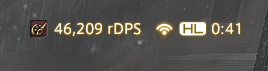

<p align="center">
  
</p>

<h1 align="center">DPS In Server Bar</h1>

<p align="center">
  Your live DPS, rDPS and party DPS — right in FFXIV's server info bar.<br>
  A <a href="https://github.com/goatcorp/Dalamud">Dalamud</a> plugin. Works with ACT, or on its own.
</p>

---

<!-- Screenshots: add them to docs/images/ and uncomment.
<p align="center">
  
  
</p>
-->

## Why

Full overlays are great, but sometimes you just want one number where your eyes already are.
DPS In Server Bar puts your DPS in the server info bar (top right of the screen) and keeps the
details one click away: per-player breakdown, graphs, pull history and an FFLogs-style rDPS.

## Features

### In the server bar

A single compact entry, for example `● [icon] DRK #1 (+8%) 21,234 rDPS ~92`. Every piece is optional
and can be **reordered**:

| Element | Example | What it shows |
|---|---|---|
| Final marker | `●` | The fight is over, this is the final value |
| Job icon / name | `[icon] DRK` | Your job, with the game's own icon |
| Rank | `#2` | Your rank in the party |
| Rank in your role | `#1 (+8%)` | Rank among tanks, healers or DPS only, and the gap to #1 (or to #2 when you are first) |
| Value | `21,234 DPS` | Personal DPS, party DPS (pDPS) or rDPS |
| Pace | `+4%` | Damage so far vs. your best **kill** of this fight, at the same second |
| Boss HP | `54%` | HP of the boss, read from the game |
| Projected kill | `ETA 9:12` | When the boss dies at the current party DPS — red if after the enrage |
| FFLogs percentile | `~92` | Estimated FFLogs percentile of your rDPS, in FFLogs colors |

- **Left click** cycles DPS → pDPS → rDPS. **Right click** opens the main window.
- **Hover** for a summary: encounter, rDPS, rank in your role, crit/DH rates, party DPS check, boss HP, projected kill, best kill, percentile.
- Colors: party DPS turns green/red against the DPS check of the fight, grey once the fight is over.

### Main window

- **Live** — every player's DPS, rDPS, damage %, crit, direct hit and deaths, sortable by DPS or rDPS.
  Hover an rDPS value to see what the player gave to / received from buffs.
  Boss HP, projected kill time and a DPS graph (rolling and average, personal or party, compared with your best kill).
- **History** — every pull is saved with its result (Kill / Wipe), duration, DPS, rDPS, rank and timeline.
  Filter by encounter, open a pull to see its breakdown and graph, tick another one to **compare** them.

### After each pull

An optional chat summary:

```
[DPS] Brute Bomber (4:32) Kill  DRK 21,234 DPS #2/8  rDPS 20,511 (~87)  best 22,000 (-3.5%)  |  pDPS 182,345 (check OK)
```

Comparisons with your best are only made between **kills** — a wipe or a prog pull says nothing about your DPS.
The summary can be turned off in dungeons.

### Party DPS checks

For each fight you can enter the **boss HP** (one click reads it from the game) and the **enrage time**:
the minimum party DPS is then `HP / enrage`. A manual minimum can be used instead. Checks can apply
to a whole zone or to a specific encounter.

### rDPS

An approximation of [FFLogs' rDPS](https://www.fflogs.com/help/rdps): damage gained from a raid buff
is taken from the player who dealt it and credited to the player who gave the buff.
See [How rDPS is computed](#how-rdps-is-computed).

### FFLogs percentile (optional)

With your own FFLogs API credentials, the plugin downloads the rDPS rankings of your job for the current fight
and places your rDPS among them. See [FFLogs setup](#fflogs-setup).

## Requirements

- FFXIV with [XIVLauncher / Dalamud](https://goatcorp.github.io/) (API 15).
- **Optional:** [ACT](https://advancedcombattracker.com/) with the FFXIV plugin and
  [OverlayPlugin](https://github.com/OverlayPlugin/OverlayPlugin), with OverlayPlugin's **WSServer** started
  (default `ws://127.0.0.1:10501/ws`).

## Installation

1. In game, open `/xlsettings` → **Experimental** → **Custom Plugin Repositories**.
2. Add:
   ```
   https://raw.githubusercontent.com/FunkyJumbo/DPS-In-Server-Bar/master/pluginmaster.json
   ```
3. Save, then install **DPS In Server Bar** from `/xlplugins`.

## Data sources

| Mode | How it works |
|---|---|
| **Auto** (default) | ACT when it is reachable, the built-in tracker otherwise |
| **ACT only** | Numbers come from ACT via OverlayPlugin's WebSocket server |
| **Built-in only** | The plugin reads your party's damage directly from the game — no ACT needed |

The built-in tracker merges pets into their owner and counts the Limit Break separately. It is slightly less
exhaustive than ACT (a DoT whose owner cannot be determined is skipped). rDPS always comes from the built-in
tracker, which also runs next to ACT when rDPS is enabled; ACT's numbers are then adjusted with it.

## Commands

| Command | Action |
|---|---|
| `/dpsbar` | Open / close the main window |
| `/dpsbar config` | Settings |
| `/dpsbar history` | Main window on the History tab |
| `/dpsbar toggle` | Cycle DPS → pDPS → rDPS |
| `/dpsbar reconnect` | Reconnect to ACT |

## Settings

| Tab | Contents |
|---|---|
| **Display** | Metric, number format (`12345` / `12,345` / `12.3k`), bar elements and their order, graphs, colors, auto-hide |
| **Party checks** | Per zone / per encounter: boss HP, enrage time, minimum party DPS |
| **Pulls** | Chat summary (and in dungeons), record only in duties, minimum pull length, history size, graph window |
| **FFLogs** | Percentile estimate, API credentials, manual encounter id |
| **Data source** | Auto / ACT / built-in, ACT address, connection status |

## How rDPS is computed

The plugin follows FFLogs' published method, as documented in
[*FFLogs Buff Allocation Math*](https://docs.google.com/document/d/1pWVsDaroDHpvh1IuB42bWLBE2TMru2CrWnjTDjeAvJY/view) by joncho:

- **% damage buffs** — the gain `N − N/M` (M = all external multipliers) is split between buffs in proportion to `ln(multiplier)`.
- **Crit / direct hit rate buffs** — a crit (or DH) is split by the probability that it came from the buffs, `(buffed − own rate) / buffed`;
  that part credits the crit (DH) multiplier to the rate buffers, in proportion to their rate.
- **Guaranteed crits / DHs** (Inner Release, Reassemble, Life Surge…) — rate buffs act as a damage multiplier, as in the game since 6.2.
- **DoTs** — buffs are snapshotted when the DoT is applied; ticks are split over all crit/DH outcomes by probability.
- Self buffs are never redistributed.

Raid buff values for the current expansion are in [`Rdps/RaidBuffs.cs`](DpsInServerBar/Rdps/RaidBuffs.cs)
(status ids come from the game data, percentages must be kept up to date by hand).

**Accuracy.** The game does not tell the client other players' crit and direct hit rates, which FFLogs knows.
The plugin estimates them from each player's hits (yours come from your real stats at level 100).
In tests against FFLogs' own meter, most players were within ±0.3%; a player receiving a large crit buff
(e.g. a Dancer's partner) can be off by about 1% on a single pull, less after a few pulls with the same group.

## FFLogs setup

1. On fflogs.com, open **[API Clients](https://www.fflogs.com/api/clients)** and create a client
   (any name, redirect URL `http://localhost`).
2. In the plugin settings, **FFLogs** tab, paste the **Client ID** and **Client Secret**.
   (The old "V1 Client Key" does not work: the plugin uses API v2.)
3. Enable the **FFLogs percentile** element in Display → Server bar elements.

The fight is matched to FFLogs by the boss' English name; if that fails, enter the FFLogs encounter id for the zone.
Rankings are cached for 24 hours. The percentile compares your rDPS with each character's best parse for your job
in the current partition — close to FFLogs' *rank %*. During a fight it is only a trend, since rDPS moves with burst windows.

## Privacy

- Pull history (`history.json`) and the FFLogs cache stay on your computer, in the plugin's configuration folder.
- The plugin only talks to ACT on your machine and, if you enable it, to the FFLogs API with your own credentials.
- FFLogs credentials are stored in the plugin's configuration file, like any other setting.

## Known limitations

- rDPS is an estimate (see [Accuracy](#how-rdps-is-computed)); raid buff values need updating when a patch changes them.
- Only the guaranteed crit/DH effects listed in `RaidBuffs.cs` are recognised.
- Enrage timers are not in the game data and must be entered by hand.
- For a fight with several bosses or HP pools, the boss HP shown is the biggest enemy's; add the pools up by hand for the DPS check.
- The FFLogs percentile depends on matching the fight by name and on FFLogs' API being reachable.

## Building

Requires the .NET 10 SDK and a Dalamud development environment (XIVLauncher with Dalamud installed).

```
dotnet build -c Release
```

The installable zip is produced in `DpsInServerBar/bin/Release/DpsInServerBar/latest.zip`.
To test in game: `/xlsettings` → **Experimental** → **Dev Plugin Locations**, add the path to
`DpsInServerBar/bin/Release/DpsInServerBar.dll`.

### Releasing

1. Bump `<Version>` in `DpsInServerBar/DpsInServerBar.csproj`, and `AssemblyVersion`, the download links and the
   changelog in `pluginmaster.json`.
2. Commit, then push a tag with the same version (e.g. `git tag 1.0.1.0 && git push origin 1.0.1.0`).
3. The **Release** workflow builds the plugin and publishes the GitHub release with `latest.zip`.

### Project layout

| Folder | Role |
|---|---|
| `Combat/` | Common model (`CombatSnapshot`), data source selection, job roles |
| `Act/` | OverlayPlugin WebSocket client and `CombatData` parser |
| `Native/` | Built-in tracker (game hooks for action effects and DoT ticks) |
| `Rdps/` | rDPS: raid buffs, allocation math, crit/DH rate estimation |
| `Tracking/` | Pulls, timelines, history, boss detection |
| `Fflogs/` | FFLogs API v2 client and percentile estimate |
| `Display/` | Server bar rendering |
| `Windows/` | Main window, graphs (ImPlot), settings |

## Credits

- [Dalamud](https://github.com/goatcorp/Dalamud) and [FFXIVClientStructs](https://github.com/aers/FFXIVClientStructs).
- joncho's *FFLogs Buff Allocation Math* for the rDPS method.
- [FFLogs](https://www.fflogs.com/) for rDPS and the rankings API.

This project is not affiliated with FFLogs, Archon or Square Enix.

## License

[AGPL-3.0-or-later](LICENSE.md)
